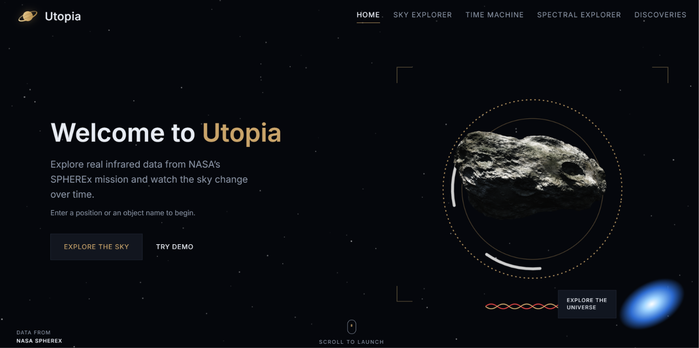

# Utopia — SPHEREx Explorer

Explore real infrared data from NASA's SPHEREx mission and watch the sky change over time.

Utopia is a website (`frontend/`) plus a FastAPI backend (`main.py`) that queries NASA/IPAC IRSA for SPHEREx observations and renders cutouts, spectra and difference images.

## Pages

- **Home:** scroll-driven rocket launch and mission facts.
- **Sky Explorer:** find every SPHEREx image covering a position or object. Layers: SPHEREx 102-band cube, WISE, DSS2, 2MASS, and a Gaia DR3 overlay.
- **Time Machine:** play through observations, compare two images, combine same-band images, and detect changes.
- **Spectral Explorer:** build a 0.75–5 µm spectrum and light curve of any target.
- **Discoveries:** review sources flagged by change detection.

## Highlights

- **Live search:** new releases (DR1, QR3 and later) appear automatically. Superseded releases are hidden.
- **Spectral Explorer:** pick detectors and a date range (launch → latest), follow moving targets with proper motion, click a point to see its cutout, and export CSV.
- **Change detection:** finds 5σ sources, compares only images at nearly the same wavelength, and labels each as brightened, dimmed, variable, appeared, disappeared or stable. It uses plain statistics, so every candidate needs verification.
- **Fast downloads:** parallel, retried, and cached in memory and on disk.

## Run it

```bash
pip install -r requirements.txt
python main.py
```

Open `http://127.0.0.1:8000`. An internet connection is needed for IRSA and VizieR.

Optional settings (environment variables): `SPHEREX_UPSTREAM_CONCURRENCY` (default 8), `SPHEREX_CHANGE_WORKERS` (6), `SPHEREX_CACHE_MB` (400), `SPHEREX_DISK_CACHE_MB` (1500), `SPHEREX_DISK_CACHE=0` to turn off the disk cache.

## URL parameters

- Sky Explorer: `?ra=&dec=&fov=`
- Spectral Explorer: `?ra=&dec=&pmra=&pmdec=&epoch=&r=&size=&det=246&release=dr1&from=&to=&embed=1`

## Notes

- Never co-add images from different detectors: they cover different wavelengths.
- Spectral Explorer is a quick-look aperture photometry tool, not IRSA's Tractor spectrophotometry.

## Acknowledgement

This publication makes use of data products from the Spectro-Photometer for the History of the Universe, Epoch of Reionization and Ices Explorer (SPHEREx), which is a joint project of the Jet Propulsion Laboratory and the California Institute of Technology, and is funded by the National Aeronautics and Space Administration.